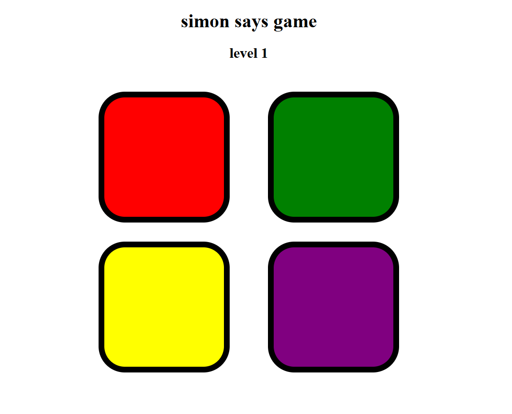

# 🎮 Simon Says Game

A fun and interactive memory-based game built using **HTML, CSS, and JavaScript**. Test your memory by remembering and repeating the sequence of flashing colored buttons. Each successful round increases the difficulty!

## 📸 Project Screenshot



## ✨ Features

- Four interactive colored buttons: Red, Yellow, Green, and Purple.
- Random color generation.
- Level-based gameplay.
- Button flashing animations.
- User input validation.
- Game Over message with final score.
- Restart the game by pressing any key.

## 🛠️ Technologies Used

- HTML5
- CSS3
- JavaScript

## 🎯 How to Play

1. Open the game in your browser.
2. Press any key to start the game.
3. Watch the flashing colored button carefully.
4. Click the corresponding colored button.
5. Remember the sequence as you progress through levels.
6. Select the wrong color and the game will end.
7. Press any key to restart.

## 🚀 How to Run Locally

1. Clone this repository:

   ```bash
   git clone https://github.com/kirankutmure66/Simon-Game.git
   ```

2. Navigate to the project folder:

   ```bash
   cd Simon-Game
   ```

3. Open `index.html` in your browser.

No additional installation or dependencies are required.

## 📂 Project Structure

```text
Simon-Game/
│
├── index.html
├── style.css
├── app.js
├── Simon_game.png
└── README.md
```

## 📚 Concepts Learned

- DOM Manipulation
- JavaScript Event Listeners
- Arrays and Functions
- Random Number Generation
- Conditional Statements
- setTimeout()
- CSS Flexbox and Animations
- Game Logic and Event Handling

## 👨‍💻 Author

**Kiran Kutmure**

GitHub: [@kirankutmure66](https://github.com/kirankutmure66)

---

⭐ If you like this project, consider giving it a star!
